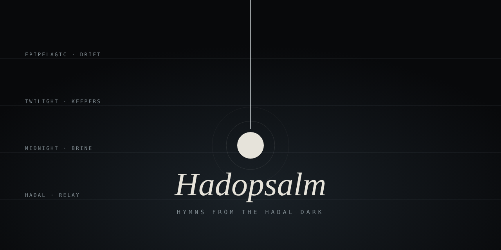

<p align="center"></p>

# Hadopsalm

**Hymns from the hadal dark.** Web riddles and wargames, rebuilt for your thumb.

Hadopsalm is a mobile-first game that turns the web-puzzle genre (lateral riddle hunts, password-ladder wargames, XSS challenges, hacking missions) into something you can actually play on a phone. Every level is a tiny website running in a sandbox on your device. The flagship feature is the interface: real tools (view source, request editing, cookies, ciphers) redesigned for touch.

*Name: **hado-** (hadal, the deepest ocean) + **psalm** (a hymn, the liturgical half of the Abyssal Liturgy design system). Pronounced HAY-doh-sahm.*

## Four descents, 30 levels

| Chapter | Zone | Levels | Spirit |
|---|---|---|---|
| **I · Drift** | 0–200 m | 8 | Lateral riddle hunt: hidden ink, URL edits, page titles, cookies, timers, redirect chains |
| **II · Keepers** | 200–1000 m | 9 | Password-ladder web wargame: comments, directory listings, robots.txt, Referer, cookies, includes, encodings, User-Agent |
| **III · Brine** | 1000–4000 m | 6 | XSS in a sealed sandbox: reflected, DOM, attribute, `javascript:` and filter bypass. Goal: make the page call `alert()` |
| **IV · Relay** | 4000–11000 m | 7 | Mission board: hidden form fields, client-side checks, Caesar, faint ink, SQL injection, hex, forged cookies |

Inspired by the *kinds* of challenges found in Notpron, OverTheWire Natas, Google's XSS Game and Hack This Site. All levels, text and code are original.

**No spoilers to look up.** Every key is derived from a random per-install seed, so a walkthrough that says "the answer is X" cannot exist. The method is the same for everyone, the answer is yours.

## The thumb-first toolkit

- **Browser with a Lens**: zoom, brightness and contrast sliders, invert, and a Lantern that lights hidden ink.
- **Source**: search, tap any line to copy it and keep it in your **Pocket**.
- **Wire**: every request and redirect hop with headers. **Hold** pauses a form or link so you can edit it before it is sent. **Craft request** builds one from scratch (method, path, headers, form body).
- **Jar**: edit cookies by touch.
- **Bench**: paste anything and see Base64, hex, binary, URL, ROT13/47, Atbash, Morse, char codes, reverse and a 25-shift Caesar sweep at once, with a "likely" marker. Chain results with *Use as input*.
- **Glyph rail**: a strip of `< > / " ' = ( ) ; { }` that floats above the keyboard, because phone keyboards bury them.
- Three hints per level (never penalised), a debrief after every level explaining the real-world lesson and the fix, haptics, offline PWA, safe areas, keyboard-aware layout.

## Safety model

Levels never touch the network or any real target. A virtual network (`js/net`) answers requests in memory, and pages render in an iframe with `sandbox="allow-scripts allow-forms"` (opaque origin, no same-origin access) under a strict CSP (`default-src 'none'`, no network, no external images, `form-action 'none'`). External links are blocked. Practise only on systems you own or have written permission to test.

## Run it

No dependencies and no bundler.

```bash
npm run dev          # http://localhost:5173  (node >= 20)
npm run fonts        # one-time: downloads Cormorant Garamond, Jost, JetBrains Mono (OFL) into /fonts
npm run verify       # proves 24 key levels solvable, for 3 different seeds
npm run test:e2e     # plays all 30 levels through the real UI in a phone-sized Chromium (needs: npm i -D playwright)
npm run build        # dist/ with a hash-versioned, precaching service worker
npm run assets       # regenerate icons and banner (needs Playwright)
```

## Deploy

Push to `main`. `.github/workflows/pages.yml` verifies the levels, fetches fonts, builds and publishes to GitHub Pages. All paths are relative, so it works at `user.github.io` or under `/repo/`. In the repo settings set **Pages → Source → GitHub Actions**.

## Architecture

```
index.html  manifest.webmanifest  sw.js
css/        tokens.css (Abyssal Liturgy) · base.css · home/screens.css · app.css
js/core/    h.js (DOM) · store.js (save, backup) · keys.js (per-install keys) · ciphers.js · icons.js · haptics.js · viewport.js
js/net/     vnet.js (virtual HTTP, DOM-free) · page.js (templates) · runtime.js (iframe bridge, alert stub)
js/ui/      browser.js · tools.js (Source, Wire, Jar, Notes, Hints, request builder) · bench.js · sheet.js · rail.js
js/screens/ home · strata · bench · record · level
js/levels/  drift.js · keepers.js · brine.js · relay.js · index.js
scripts/    serve · build · fetch-fonts · generate-assets · verify-levels · e2e
```

### Adding a level

Add an object to a chapter file:

```js
L({
  id: 'drift-9', title: 'My Level', depth: 150,
  site: (req, ctx, st) => page('Title', `<p>The key is <b>${ctx.key}</b></p>`),  // req: {method,path,query,form,headers,cookies}
  hints: ['whisper', 'nudge', 'map'],
  debrief: { title: 'What it taught', text: '…' },
  proof: async (net, ctx) => (await net.get('/')).final.res.body.match(/<b>([^<]+)</)[1],
})
```

`npm run verify` runs `proof` against several seeds. Use `ctx.key` for the answer and `ctx.aux` for a second per-install word. Brine levels set `goal: 'alert'`-style behaviour by living in `brine.js` and provide `inject` and `payload` (checked by the e2e test).

## Design system

Abyssal Liturgy: near-black `#08090b`, bone `#e6e3da`, desaturated steel tints, Cormorant Garamond italic for voice, Jost for text, JetBrains Mono for code, hairline borders, no gradients on UI chrome, 44 px+ touch targets.

## License

MIT. Fonts are SIL OFL 1.1, fetched from Fontsource at build time.
